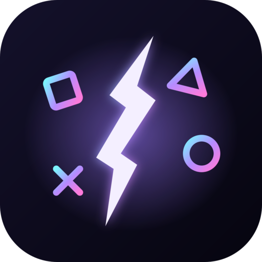
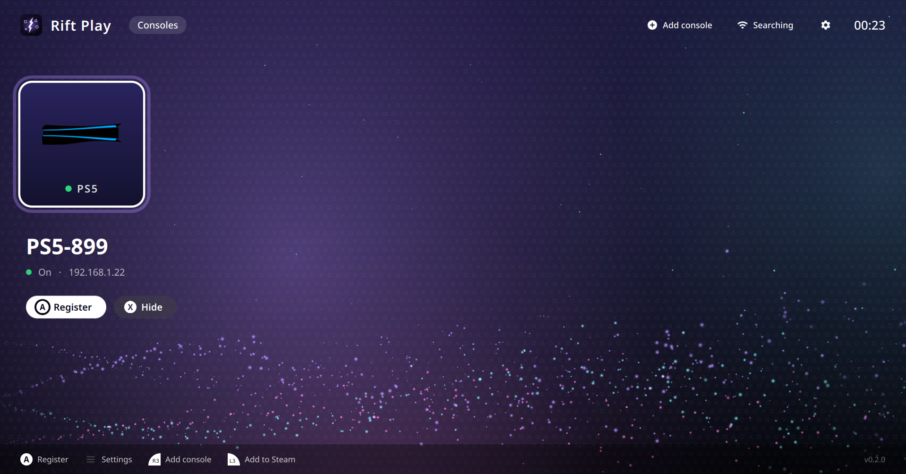

<p align="center">
  
</p>

<h1 align="center">Rift Play</h1>

<p align="center">
  <b>PlayStation Remote Play, tuned for the Retroid Pocket 6 on ArmadaOS.</b><br>
  Turn your RP6 into a dedicated remote play handheld for your PS5 / PS4.
</p>

<p align="center">
  <a href="../../releases/latest"></a>
  
  
</p>

<p align="center"></p>

> **Status: early / experimental.** The first builds are being tested on real hardware right now.
> Feedback and logs are very welcome in [Issues](../../issues).

---

## Why Rift Play

The Retroid Pocket 6 has a Snapdragon 8 Gen 2, a 1080p 120 Hz AMOLED screen and Wi‑Fi 7 —
more than enough to be a better remote play handheld than a dedicated one.
[ArmadaOS](https://armadaos.dev) gives it a real Linux system with Steam Game Mode.
Rift Play is a remote play client built specifically for that combination.

### What's different from stock chiaki-ng

| | chiaki-ng (Flathub) | Rift Play |
|---|---|---|
| Hardware video decoding on Snapdragon | ❌ not built in (VA-API / Vulkan only) | ✅ V4L2 mem2mem (Qualcomm video engine) |
| Software decoding | 1 thread | multithreaded (slice threads, no extra latency) |
| Decode latency | default | low-delay mode, no frame reordering buffer |
| CPU tuning | generic ARMv8 | tuned for Snapdragon 8 Gen 2 (Cortex‑X3/A715) |
| PS button on handhelds | — | ✅ Select+Start combo · swipe-down touch bar |
| Home screen | list view | ✅ console-style launcher |
| Installs alongside the Flathub version | — | ✅ separate app ID |

### Roadmap

- [x] Hardware decoding path for Snapdragon (V4L2)
- [x] Multithreaded, low-latency software fallback
- [ ] Verified on RP6 + ArmadaOS (in progress)
- [ ] High quality upscaling: 720p stream → 1080p screen, 1080p → 4K over USB‑C/TV out
- [x] New console-style home screen designed around the RP6 controls
- [x] PS button: Select+Start combo and swipe-down touch quick bar
- [ ] 120 Hz presentation tuning for the RP6 panel

---

## Install

1. Download `RiftPlay-aarch64.flatpak` from the [latest release](../../releases/latest).
2. On the RP6, switch to **Desktop Mode** and open a terminal in the download folder:
   ```bash
   flatpak install --user RiftPlay-aarch64.flatpak
   ```
3. Add it to Steam as a **non‑Steam game** with the command:
   ```
   flatpak run io.github.riftplay.RiftPlay
   ```
4. Go back to Game Mode, launch Rift Play and register your console
   (settings are separate from chiaki-ng, so you need to register once).

**Recommended settings:** Hardware decoder: `auto` · Renderer: Vulkan · Resolution: 1080p · FPS: 60.

### Steam Deck (experimental)

There is also an x86_64 build for the Steam Deck: same steps as above, but download
`RiftPlay-x86_64.flatpak` and install it in Desktop Mode with
`flatpak install --user RiftPlay-x86_64.flatpak`. It decodes through VA-API on the Deck's
AMD GPU and is compiled for `x86-64-v3`, tuned for the Deck's Zen 2 CPU, so it needs an
x86 CPU with AVX2 (roughly 2015 or newer). The Snapdragon tuning only applies to the RP6 build. The x86_64 bundle does not
update through `flatpak update` yet: install the new bundle from each release.

### Reporting a problem

Start a stream, close it, then attach the newest file from the `log` folder under
`~/.var/app/io.github.riftplay.RiftPlay/data/` to an [issue](../../issues).
The log says which decoder was picked (`v4l2m2m`, software, …).

---

## Build from source

The release builds are produced by GitHub Actions on native ARM runners
(see [`.github/workflows/build.yml`](.github/workflows/build.yml)).
To build locally on an aarch64 machine (or x86_64 with `qemu-user-static`):

```bash
flatpak install --user flathub org.kde.Sdk//6.11 org.kde.Platform//6.11 io.qt.qtwebengine.BaseApp//6.11
flatpak-builder --user --arch=aarch64 --force-clean --repo=repo build-dir flatpak/io.github.riftplay.RiftPlay.yaml
flatpak build-bundle --arch=aarch64 repo RiftPlay-aarch64.flatpak io.github.riftplay.RiftPlay
```

---

## Credits & license

Rift Play is a fork of [**chiaki-ng**](https://github.com/chiaki-ng/chiaki-ng) by Street Pea and
contributors, itself based on [Chiaki](https://git.sr.ht/~thestr4ng3r/chiaki) by Florian Märkl.
All the hard work on the Remote Play protocol is theirs. The original README is kept in
[`README.chiaki-ng.md`](README.chiaki-ng.md).

Licensed under the **GNU Affero General Public License v3.0** — see [`COPYING`](COPYING) and [`LICENSES/`](LICENSES).

Rift Play is not affiliated with, endorsed by, or connected to Sony Interactive Entertainment,
Retroid, or the ArmadaOS project. "PlayStation", "PS4" and "PS5" are trademarks of
Sony Interactive Entertainment Inc.
